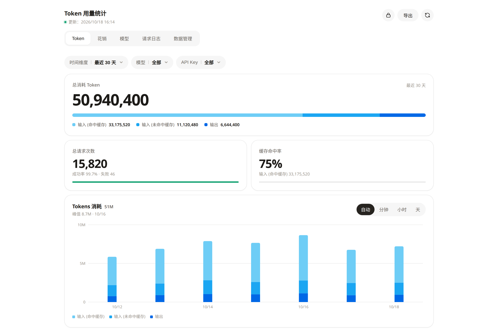
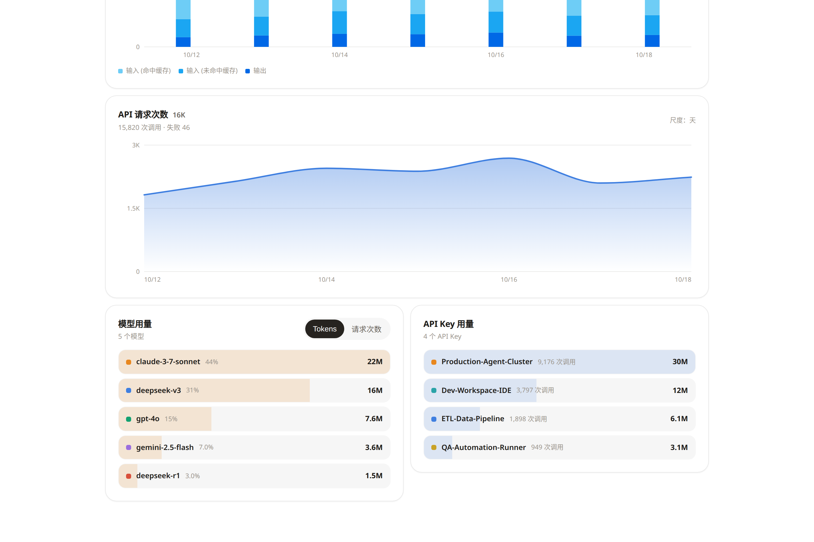
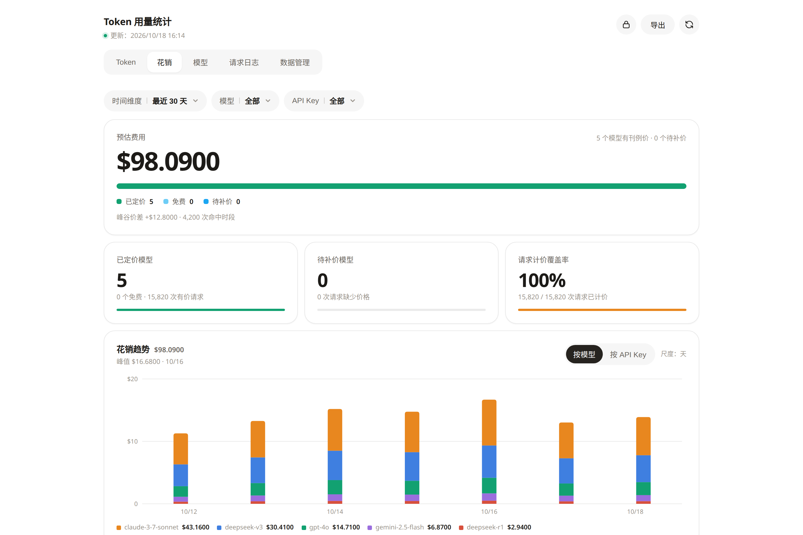
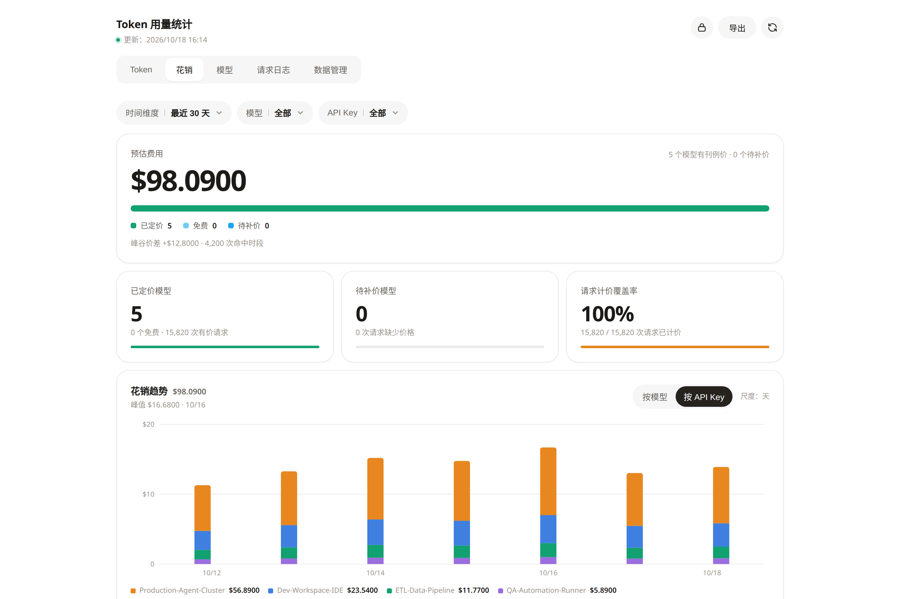
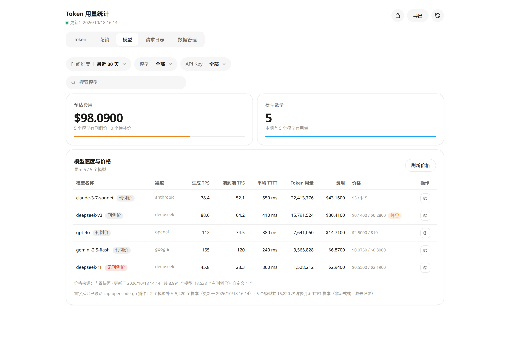
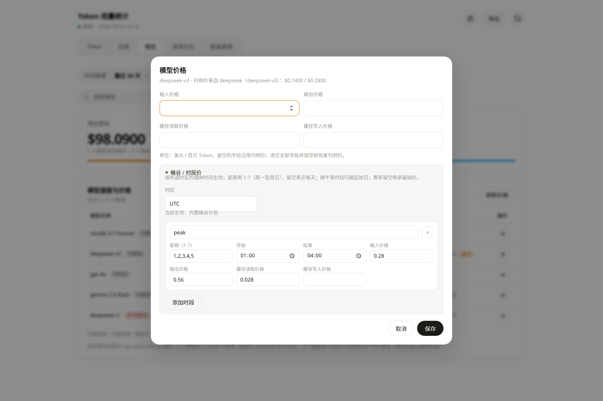
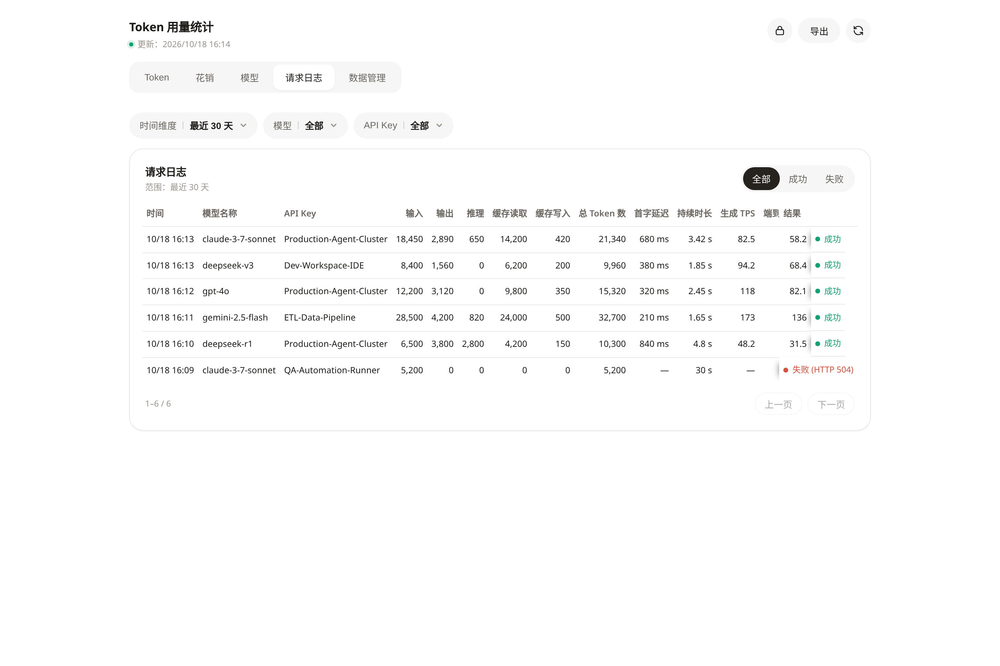

# CAP Token Usage Tracker

[](LICENSE)
[](https://github.com/router-for-me/CLIProxyAPI)

**[English](README.md)** | **[简体中文](README_zh.md)** | **[日本語](README_ja.md)** | **[Français](README_fr.md)** | **[한국어](README_ko.md)**

---

**CAP Token Usage Tracker** est un plugin persistant d'analyse de consommation de tokens et de coûts conçu pour [CLIProxyAPI](https://github.com/router-for-me/CLIProxyAPI). Intégré directement via le système officiel d'extension, il enregistre les métadonnées par requête et les agrégations à la minute dans une base de données locale légère et propose un tableau de bord visuel interactif.

Mesurez la répartition de vos tokens, l'efficacité du cache de prompt, l'estimation financière de vos dépenses et la réactivité réelle de chaque modèle d'IA sans déployer d'infrastructure de supervision lourde.

---

## Fonctionnalités clés et aperçu visuel

### 1. Statistiques des tokens et efficacité du cache de prompt

Visualisez en temps réel le volume de vos échanges et quantifiez précisément les gains apportés par le cache de contexte.

- **Répartition détaillée des tokens** : Distinguez d'un coup d'œil les tokens d'entrée, de sortie et les tokens servis par le cache.
- **Taux de succès du cache (Cache Hit Rate)** : Mesurez le pourcentage de réutilisation du cache de prompt pour évaluer vos gains d'optimisation.
- **Échelles de temps dynamiques** : Basculez entre les résolutions minute, heure et jour avec un alignement sans trou sur l'axe temporel.



---

### 2. Classement de consommation par Modèle et Clé API

Identifiez rapidement la provenance de vos consommations au sein de vos équipes ou projets.

- **Diagrammes de répartition horizontale** : Suivez les parts relatives de consommation pour chaque modèle et chaque clé API active.
- **Étiquettes métier explicites** : Associez les empreintes chiffrées de vos clés API à des noms lisibles (ex. `Production-Agent-Cluster`, `Dev-Workspace-IDE`).
- **Courbe de trafic lissée** : Surveillez l'évolution du volume de requêtes par minute ou par heure ainsi que le taux d'erreur.



---

### 3. Calcul des coûts en temps réel et attribution financière

Évitez les mauvaises surprises en fin de mois grâce à une estimation dynamique en dollars basée sur le catalogue `models.dev`.

- **Catalogue tarifaire intégré** : Inclut les tarifs de référence de plus de 8 000 modèles avec actualisation automatique en arrière-plan.
- **Bascule instantanée** : Alternez l'histogramme des coûts entre **Par Modèle** et **Par Clé API** en un clic sans recharger la page.
- **Tarification heures pleines / creuses** : Prend en charge les règles de remise temporelle (telles que les plages horaires DeepSeek) et affiche les écarts de coûts.
- **Calcul dynamique** : Les coûts sont évalués à la volée ; toute modification tarifaire recalcule immédiatement l'historique sans altérer la base de données.

#### Tendance des coûts par Modèle


#### Répartition des coûts par Clé API


---

### 4. Indicateurs de performance et tarification sur mesure

Mesurez la vitesse réelle d'exécution de vos modèles et adaptez les tarifs à vos accords fournisseurs.

- **Double métrique TPS** : Suivez à la fois le **TPS de génération** (vitesse pure d'écriture des tokens) et le **TPS de bout en bout** (latence totale).
- **Délai du premier token (TTFT)** : Évaluez avec précision la latence du premier token émis, avec possibilité de corrélation inter-plugins.
- **Ajustement tarifaire individuel** : Configurez manuellement les coûts d'entrée, de sortie, de lecture et d'écriture de cache pour chaque modèle.





---

### 5. Journal détaillé des requêtes et diagnostic d'incidents

Tracez l'intégralité du cycle de vie de chaque appel API pour diagnostiquer les lenteurs et anomalies amont.

- **Colonnes de diagnostic complètes** : Horodatage, modèle, canal, libellé de clé API, détail des tokens, TTFT, latence et TPS.
- **Filtrage rapide par statut** : Isolez instantanément les requêtes échouées pour inspecter les erreurs HTTP 500, 504 (timeout) ou quotas dépassés.



---

## Démarrage rapide

### Étape 1 : Téléchargement et installation

Téléchargez la bibliothèque dynamique adaptée à votre plateforme depuis la page des [Releases](https://github.com/AITNR/cap-token-usage-tracker/releases) et déposez-la dans le répertoire `plugins` de CLIProxyAPI :

| Plateforme et Architecture | Chemin cible |
|---|---|
| Linux amd64 | `plugins/linux/amd64/cap-token-usage-tracker.so` |
| Linux arm64 | `plugins/linux/arm64/cap-token-usage-tracker.so` |
| Windows amd64 | `plugins/windows/amd64/cap-token-usage-tracker.dll` |
| macOS (Intel) | `plugins/darwin/amd64/cap-token-usage-tracker.dylib` |
| macOS (Apple Silicon) | `plugins/darwin/arm64/cap-token-usage-tracker.dylib` |

### Étape 2 : Configuration

Activez le plugin dans le fichier `config.yaml` de CLIProxyAPI :

```yaml
plugins:
  enabled: true
  dir: plugins
  configs:
    cap-token-usage-tracker:
      enabled: true
      retention_days: 365
      api_key_secret: "votre-cle-secrete-aleatoire-d-au-moins-32-octets"
      pricing_auto_refresh: true
      peak_pricing: true
```

### Étape 3 : Accès au tableau de bord

Démarrez CLIProxyAPI et ouvrez l'URL suivante dans votre navigateur :

```text
http://127.0.0.1:8317/v0/resource/plugins/cap-token-usage-tracker/dashboard
```

Saisissez la clé d'administration (Management Key) de CLIProxyAPI pour déverrouiller l'accès aux données et graphiques.

---

## Sécurité et respect de la confidentialité

- **Aucun enregistrement de contenu** : Le plugin n'enregistre jamais les invites (prompts), le corps des requêtes, les réponses des modèles ou les en-têtes confidentiels.
- **Anonymisation des clés API** : Les clés API en clair ne sont jamais persistées. Elles sont indexées par empreintes irréversibles HMAC-SHA256 salées et chiffrées au repos par générations cryptographiques.
- **Stockage strictement local** : Toutes les données restent cantonnées dans votre fichier local `bbolt` sans aucune communication vers des serveurs tiers.
- **Protection par session** : Toute requête externe non authentifiée vers les routes de données reçoit immédiatement un code `401 Unauthorized`.

---

## Architecture technique et Référence API

Pour les instructions de compilation CGO, la compilation croisée, l'architecture du moteur de stockage et la documentation complète des API REST, veuillez consulter le document dédié :

👉 **[Architecture technique et Référence API (docs/TECHNICAL.md)](docs/TECHNICAL.md)**

---

## Licence

Ce projet est distribué sous licence [MIT](LICENSE).
